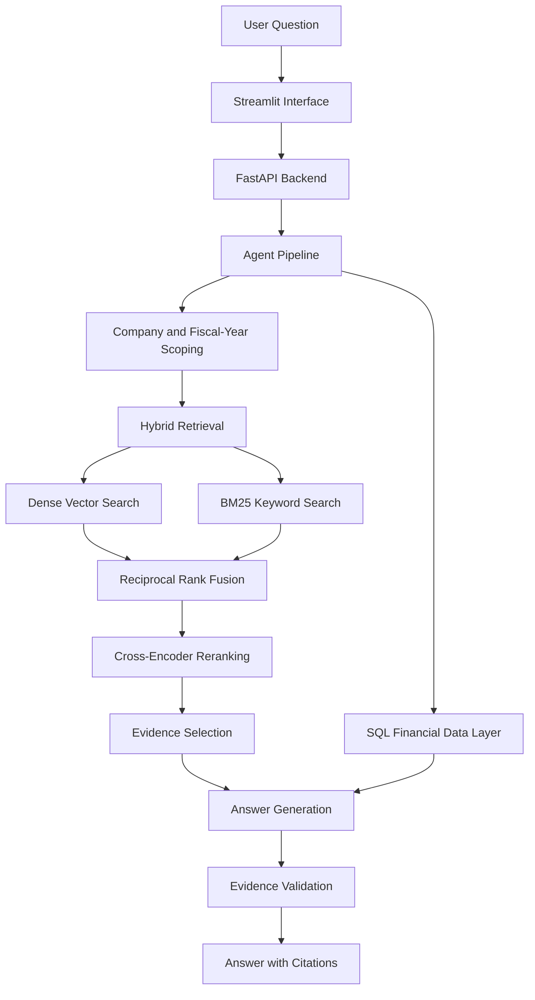
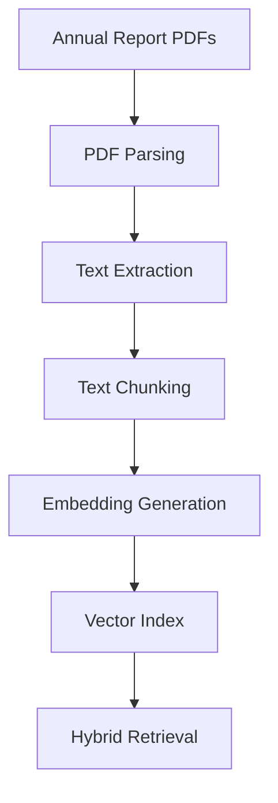

# FinSight — AI-Powered Financial Intelligence Platform


FinSight is an AI-powered financial intelligence platform designed to help users research Indian companies through their annual reports and structured financial data.

It combines Retrieval-Augmented Generation (RAG), hybrid information retrieval, BM25 keyword search, dense vector retrieval, cross-encoder reranking, SQL-based financial data access, and evidence validation to produce source-grounded answers.

FinSight aims to make financial research more accessible, traceable, and reliable by connecting natural-language questions with financial reports and structured company data.

## 🚀 Live Demo

**Try FinSight here:** [Launch FinSight](https://yes-containers-tool-facility.trycloudflare.com)

> Note: This is a temporary Cloudflare demo link. The application is accessible while the hosting laptop and tunnel are running.

---

## Key Features

### Financial Research

- **Annual Report Question Answering:** Ask natural-language questions about company annual reports.
- **Hybrid Information Retrieval:** Combines dense vector retrieval with BM25 keyword search.
- **Reciprocal Rank Fusion:** Merges results from multiple retrieval strategies.
- **Cross-Encoder Reranking:** Reorders retrieved passages to improve evidence relevance.
- **Company-Aware Retrieval:** Restricts research to the relevant company's documents.
- **Fiscal-Year Scoping:** Uses fiscal-year context to narrow relevant evidence.
- **Financial Data Access:** Retrieves structured financial information through a SQL-backed data layer.
- **Evidence-Grounded Answers:** Generates responses using retrieved financial evidence.
- **Source Citations:** Provides document names, page numbers, chunk identifiers, and supporting evidence.
- **Evidence Validation:** Checks that supporting quotations and numerical claims are grounded in the supplied evidence.
- **Abstention Handling:** Avoids inventing answers when sufficient evidence is unavailable.

### Separate Application Workspaces

FinSight provides separate experiences for different tasks:

- **Financial Research:** Focused on annual reports, company performance, financial metrics, and evidence-backed research.
- **General Assistant / Career Guide:** A separate assistant experience using the local Ollama model.

### Evaluation and Testing

- Retrieval benchmark using 40 questions.
- Answer evaluation components.
- Unit and integration tests using pytest.
- Tests for retrieval, financial metrics, answer generation, citations, and API behavior.

---

## Technology Stack

| Area | Technologies |
|---|---|
| Programming Language | Python 3.11 |
| Backend | FastAPI, Uvicorn |
| Frontend | Streamlit |
| PDF Processing | PyMuPDF |
| Dense Retrieval | Sentence Transformers |
| Keyword Retrieval | BM25 |
| Retrieval Fusion | Reciprocal Rank Fusion |
| Reranking | Cross-Encoder |
| LLM Runtime | Ollama |
| Data Validation | Pydantic |
| Financial Data | SQL |
| Testing | pytest |
| Code Quality | Ruff |
| Dependency Management | uv |
| Version Control | Git, GitHub |

---

## System Architecture

### Financial Research Architecture



### Document Ingestion Pipeline



---

## Current Dataset and Coverage

The current annual-report retrieval vertical slice covers six major Indian IT companies.

| Company | NSE Symbol |
|---|---|
| HCL Technologies | HCLTECH |
| Infosys | INFY |
| LTIMindtree | LTM |
| Tata Consultancy Services | TCS |
| Tech Mahindra | TECHM |
| Wipro | WIPRO |

The project also includes a company-master building utility intended to support broader Indian company coverage.

**Important:** Having a company reference master does not mean that annual reports for every listed company have already been ingested and indexed. Current annual-report retrieval coverage is limited to the six companies above.

### Current Retrieval Dataset

| Component | Coverage |
|---|---:|
| Document chunks | 5,019 |
| Embedding dimensions | 384 |
| Company-specific document collections | 6 |
| Initial retrieval benchmark | 40 questions |

Generated indexes, raw annual-report PDFs, and local database artifacts are not included as part of the normal GitHub source-code distribution.

---

## Retrieval Evaluation

FinSight was evaluated using an initial 40-question retrieval benchmark.

### Hybrid Retrieval and Reranking Baseline

| Metric | Result |
|---|---:|
| Page Recall@5 | 76.25% |
| Page Recall@10 | 87.50% |
| Page Recall@50 | 100.00% |
| Chunk Recall@5 | 70.83% |
| Chunk Recall@10 | 83.33% |
| Chunk Recall@50 | 98.75% |
| Reranked Chunk Recall@10 | 88.75% |
| Reranked MRR@10 | 0.6590 |
| Reranked NDCG@10 | 0.7105 |

The reranking stage improved chunk Recall@10 from 83.33% to 88.75% on this benchmark.

**Evaluation limitation:** These metrics measure retrieval relevance. They do not represent overall answer accuracy, factual correctness, or faithfulness.

---

## Verified Example

A live API test was performed using the question:

> What was Tech Mahindra operating margin in FY 2025-26?

FinSight returned:

**Answer:** The consolidated operating margin, reported as EBIT margin, was **12.6%**.

| Citation Detail | Result |
|---|---|
| Company | Tech Mahindra |
| Fiscal Year | FY 2025–26 |
| Reporting Basis | Consolidated |
| Document | `techmahindra_annual_report_2025_26.pdf` |
| Page | 127 |
| Chunk | `page-127:chunk-2` |
| Abstention | False |

The cited annual-report passage contains the Consolidated Financial Performance section and explicitly reports the EBIT margin of 12.6%.

This example demonstrates the connection between the API answer and its supporting annual-report evidence.

---

## Project Structure

```text
FinSight/
│
├── app/
│   └── streamlit_app.py
│
├── data/
│   └── eval/
│       ├── answer_golden_set.json
│       └── retrieval_golden_set.json
│
├── scripts/
│   ├── add_tcs_historical_reports.py
│   ├── build_company_master.py
│   ├── build_embeddings.py
│   ├── build_multi_company_index.py
│   ├── build_tier1_40_benchmark.py
│   └── run_retrieval_eval.py
│
├── src/
│   └── finsight/
│       ├── agent/
│       │   ├── factory.py
│       │   └── pipeline.py
│       │
│       ├── api/
│       │   └── main.py
│       │
│       ├── chat/
│       │   └── service.py
│       │
│       ├── evaluation/
│       ├── generation/
│       ├── llm/
│       ├── retrieval/
│       └── sql/
│
├── tests/
│
├── pyproject.toml
├── uv.lock
├── .gitignore
└── README.md
```

---

## Getting Started

### Prerequisites

- Python 3.11
- Git
- [uv](https://docs.astral.sh/uv/)
- [Ollama](https://ollama.com/)

### 1. Clone the repository

```bash
git clone https://github.com/woohasri-ai/FinSight.git
cd FinSight
```

### 2. Set up the Python environment

Install project dependencies:

```bash
uv sync --group dev
```

Activate the environment in Windows PowerShell:

```powershell
.venv\Scripts\Activate.ps1
```

### 3. Configure the local LLM

Install and start Ollama.

Download the model used by the current local General Assistant configuration:

```bash
ollama pull qwen2.5:1.5b
```

Make sure the Ollama service is running and the configured model is available.

### 4. Prepare the project data

FinSight requires prepared annual-report document indexes and structured financial database artifacts.

These generated artifacts are not distributed as part of the GitHub source-code repository.

Use the included preparation and indexing scripts with the required source reports and configuration before running Financial Research against a fresh clone.

### 5. Start the FastAPI backend

```bash
uv run uvicorn finsight.api.main:app --host 127.0.0.1 --port 8000 --reload
```

Backend health endpoint:

```text
http://127.0.0.1:8000/health
```

Interactive API documentation:

```text
http://127.0.0.1:8000/docs
```

### 6. Start the Streamlit frontend

Open a second terminal in the project directory:

```bash
uv run streamlit run app/streamlit_app.py
```

Open the local application:

```text
http://localhost:8501
```

The frontend connects to the FastAPI backend at:

```text
http://127.0.0.1:8000
```

---

## API Endpoints

| Method | Endpoint | Purpose |
|---|---|---|
| GET | `/health` | Backend health check |
| POST | `/ask` | Financial Research questions |
| POST | `/chat` | General Assistant questions |

For request schemas and interactive testing, open the Swagger interface:

`http://127.0.0.1:8000/docs`

---

## Running Tests

Run the complete automated test suite:

```bash
uv run pytest -q
```

### Latest Verified Test Result

**353 tests passed, 0 failures.**

This result was obtained locally on November 24, 2026.

Run code-quality checks:

```bash
uv run ruff check .
```

---

## Reliability and Limitations

FinSight is designed to prioritize source evidence over unsupported answers.

- Financial answers should be grounded in retrieved annual-report evidence or structured financial records.
- Citations identify the supporting document and page.
- Evidence validation helps detect unsupported quotations and numerical claims.
- The application can abstain when sufficient supporting evidence is unavailable.
- Company coverage depends on the reports and financial records actually indexed.
- Retrieval evaluation results should not be confused with answer-quality scores.
- Financial research is intended for information and analysis, not investment recommendations.

---

## Future Improvements

- Expand indexed annual-report coverage across additional leading Indian listed companies.
- Expand the initial 40-question benchmark to 80 questions.
- Improve financial table and metric extraction.
- Measure answer correctness, faithfulness, and abstention quality.
- Improve retrieval performance and response latency.
- Enhance the frontend experience and visual presentation.
- Extend the General Assistant capabilities.
- Add more application screenshots and a demonstration video.
- Improve deployment and production-readiness.

---

## Author

**Wooha Sri**

B.Tech — Artificial Intelligence and Machine Learning

Aspiring AI/ML Engineer interested in building practical AI-powered applications and production-oriented intelligent systems.

- [LinkedIn](https://www.linkedin.com/in/woohasri-midde-a289b4297/)
- [GitHub](https://github.com/woohasri-ai)

---

*FinSight — Turning financial reports into evidence-backed answers.*
